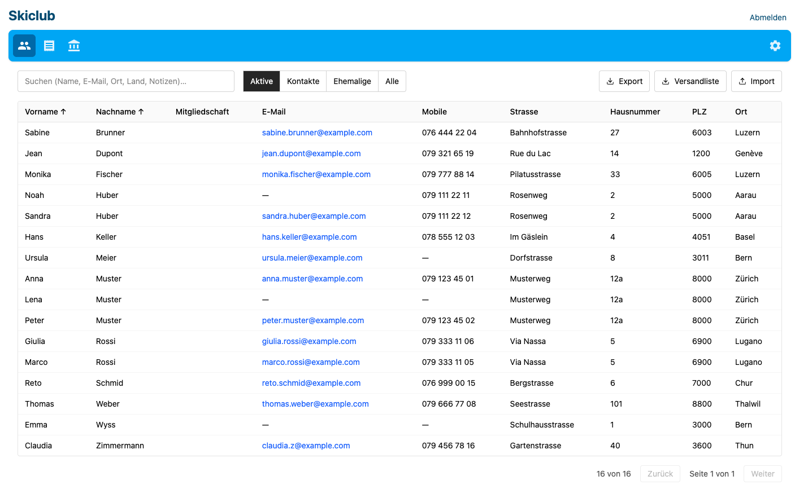
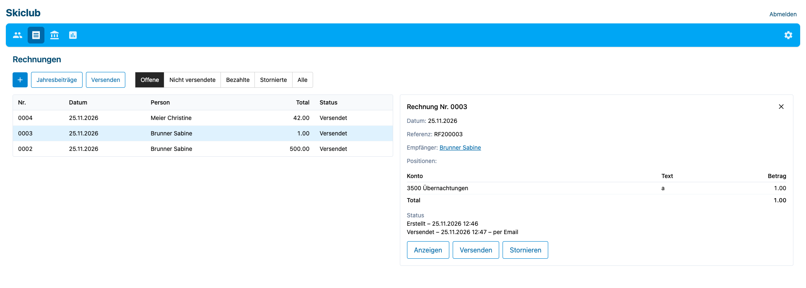
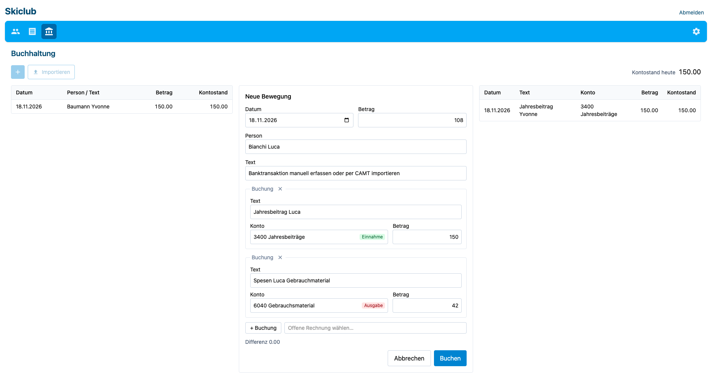

# Club Admin

> simple club administration, open-source, free

## Features

- Addresses (active members, former members, contacts)
  - Add/Edit
  - Import/Export
  - Download addresses grouped by the same address (Versand)
- Invoices
  - Create single invoices
  - Create batch invoices for yearly fee (grouped by address, other payer functionality)
  - Sending invoices (SMTP, ePost)
- Accounting
  - Cash basis accounting (Einnahmen-Ausgaben-Rechnung)
- Reporting
  - Income-Statement (Erfolgsrechnung)
  - Additional financial reporting (planned)
- German user interface.

> [!WARNING] 
> This might not be for you, if...
> - your club has more than 500 addresses
> - you need customisation and don't know how to code
> - you need support operating a webapp

## Screenshots

## Getting started

The easiest way to get started is to deploy to Railway
with switched off authentication. Ask your agent how to switch off authentication. See [deployment.md](./docs/manual/deployment.md) for productive and local deployment.

## Stack

- Frontend: React, Tanstack Query, Tailwind
- Backend: C#, ASP.NET Core
- DB: Postgres
- Object Storage: S3
- IAM: Azure Entra

## Contributing

Use the GitHub issues for collaboration.

This repository uses the [Matt Pocock skills](https://www.aihero.dev/skills) for coding agents. Conventions for review are in [CODING_STANDARDS.md](./CODING_STANDARDS.md), the domain language in [GLOSSARY.md](./GLOSSARY.md).